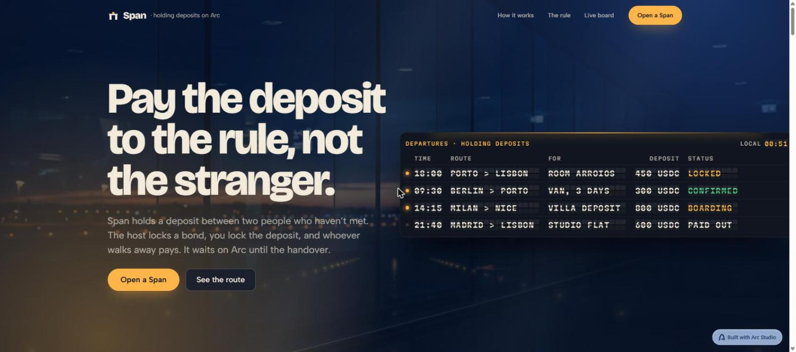
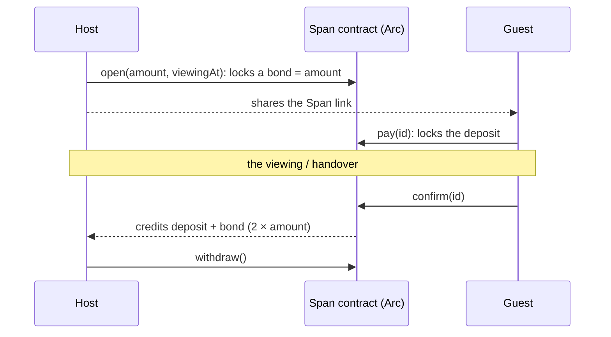
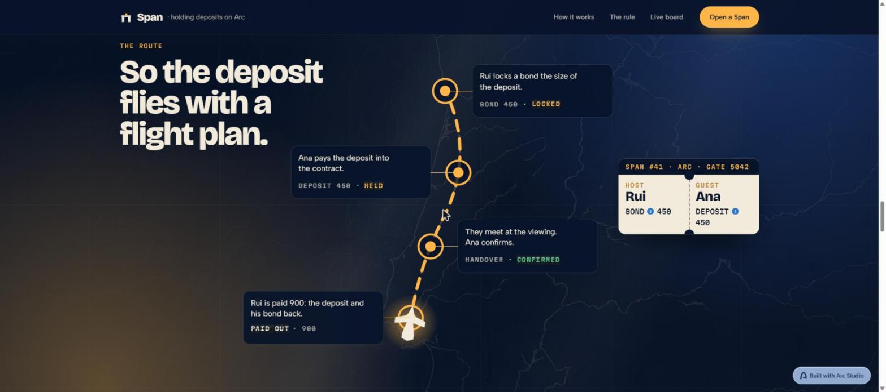
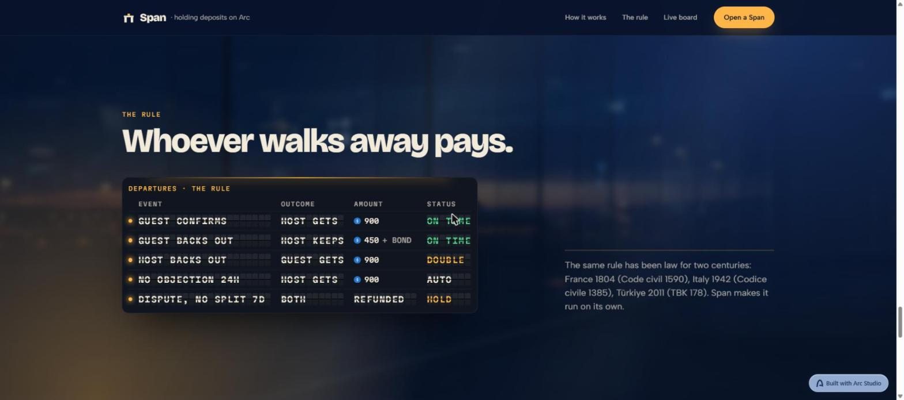

<div align="center">

# Span

**Holding deposits between strangers, on Arc.**
The host locks a bond. The guest locks the deposit. Whoever walks away pays.

[Live app](https://span-arc.pages.dev) · [Contract on Arc mainnet](https://explorer.arc.io/address/0x17126d2F33C988fcF11952423d4585Bf94b1Cf67) · [Arc Studio project](https://studio.arc.io/app/9b691344-0713-40e0-9f9b-bb86fbe978dd)




</div>

## The problem

Renting a room in another city, booking a holiday flat or reserving a van usually starts with a deposit sent to someone you have never met. That is exactly how rental and booking scams work: the money goes to a stranger by wire or instant transfer, then the listing disappears. In the US, 46% of people who lost money to rental scams were aged 18 to 29 (FTC, 2025). Card and platform protections do not cover these payments, because they happen outside the platform.

The fair rule already exists. Civil codes have said it for two centuries: whoever backs out of a deposit loses it, and whoever took it and backs out pays it back twice (France, Code civil art. 1590, 1804; Italy, Codice civile art. 1385, 1942; Türkiye, TBK md. 178, 2011). What was missing is a way to make a stranger follow it.

## How Span works



| What happens | Host gets | Guest gets |
| --- | --- | --- |
| Guest confirms at the handover | deposit + own bond | – |
| Guest backs out before the viewing | deposit + own bond | – |
| Host backs out | – | deposit + host bond (**double**) |
| Nobody objects within 24 h after the viewing | deposit + own bond (anyone can release) | – |
| Guest disputes, both propose the same split | bond + rest of the deposit | the agreed share |
| Still disputed 7 days after the 24 h window | bond back | deposit back |
| Host cancels before anyone paid | bond back | – |

There is no arbiter, no owner, no admin key, no pause, no upgrade path and no fee. Every closing path credits exactly `2 × amount`, so the contract's USDC balance always equals what it owes.

<table>
<tr>
<td></td>
<td></td>
</tr>
</table>

## Why Arc

- **USDC is the native gas token**, so a guest needs one asset, not two, and every action costs a fraction of a cent.
- **Sub-second finality**: the deposit is locked or released while both people are still looking at their phones.
- **Dollar-denominated by default**: a deposit agreed in dollars stays in dollars between strangers in different countries.

## Contract

[`contracts/Span.sol`](contracts/Span.sol) · Solidity 0.8.28 · OpenZeppelin `SafeERC20` + `ReentrancyGuard`

| Function | Who | When |
| --- | --- | --- |
| `open(amount, viewingAt, allowedGuest, ref)` | host | locks the bond; `allowedGuest = 0x0` lets anyone with the link pay; `ref` is the hash of the listing text |
| `cancel(id)` | host | before anyone paid |
| `pay(id)` | guest | before the viewing |
| `confirm(id)` | guest | any time the deposit is locked |
| `guestWalkAway(id)` / `hostWalkAway(id)` | guest / host | guest only before the viewing; host any time while locked |
| `release(id)` | anyone | 24 h after the viewing, if nobody disputed |
| `dispute(id)` | guest | within 24 h after the viewing |
| `proposeSplit(id, toGuest)` | host or guest | while disputed; executes when both propose the same split |
| `timeout(id)` | anyone | 7 days after the dispute window, refunds both sides |
| `withdraw()` | anyone with credit | pull payment of everything owed to the caller |

**Security model**

- **Pull payments.** Closing a Span never transfers tokens; it credits balances. Each side withdraws its own credit, so a USDC-blocklisted or unresponsive counterparty can never lock the other side's money.
- **Arc specifics.** Accounting uses the 6-decimal USDC ERC-20 interface at `0x3600…0000`, never `msg.value`, so Arc's 18-decimal native balance can't be mixed in.
- **Checks-effects-interactions** and `nonReentrant` on every state-changing function; custom errors for every rejected call.
- **Tests.** 66 Foundry tests: every path above, time-window edges at exactly `viewingAt` and `viewingAt + 24h`, wrong callers and double actions, blocklisted withdrawals, a fuzz test over any amount and split, and an invariant run (128,000 random calls) asserting `balance == unclaimed credits + live escrow`.
- The contract has not had an independent professional audit. Use small amounts.

## Deployments

| Network | Address | Deploy tx |
| --- | --- | --- |
| Arc mainnet (5042) | [`0x17126d2F33C988fcF11952423d4585Bf94b1Cf67`](https://explorer.arc.io/address/0x17126d2F33C988fcF11952423d4585Bf94b1Cf67) | [`0x0950…5d63`](https://explorer.arc.io/tx/0x09502686485bd5abb320ae1a8a18b6533c3ef45a62063e1370d6961d9ca55d63) |
| Arc Testnet (5042002) | [`0xacf81a650c5b2741e280e666ef9ee9666ad131e8`](https://explorer.testnet.arc.io/address/0xacf81a650c5b2741e280e666ef9ee9666ad131e8) | [`0x33ba…378a`](https://explorer.testnet.arc.io/tx/0x33bac5e9bf56014dea3d67fca62dd6123d511b49a399d2679059702d77ee378a) |

**First Span on mainnet** (1 USDC deposit, [`/s/1`](https://span-arc.pages.dev/s/1?t=Room%20in%20Arroios%2C%20Lisbon)), host `0x39AE…5794`, guest `0x707B…ecd3`:

| Step | Tx |
| --- | --- |
| Host opens the Span and locks a 1 USDC bond | [`0xeb51…53ef`](https://explorer.arc.io/tx/0xeb51376345d171af46e71d557b3f1011bc7bd26d37a34779cd2fb386603153ef) |
| Guest pays the 1 USDC deposit | [`0xcca3…91c6`](https://explorer.arc.io/tx/0xcca3f5a6464b55cf3c0c74d5df383fc33f44cf02623dc74972d2733f5ae391c6) |
| Guest confirms the handover | [`0x395d…a007`](https://explorer.arc.io/tx/0x395d19adb764b7d9b16d5db959a6ab88e43c577ea02a23ee011205a2b61fa007) |
| Host withdraws 2 USDC | [`0x43c2…44f2`](https://explorer.arc.io/tx/0x43c2effa5781221fa91b7e7cee8bd92bf5d3202476ee3cb2250332615ef244f2) |

Both use USDC `0x3600000000000000000000000000000000000000`. The mainnet contract is the exact bytecode Arc Studio compiled and tested (solc 0.8.28), deployed from the builder's own wallet because Arc Studio deploys to testnet only and Circle API-key creation failed for this account. The runtime code matches the compiled `deployedBytecode` except for the immutable USDC address slots.

## Built with Arc Studio

The whole project lives in one [Arc Studio project](https://studio.arc.io/app/9b691344-0713-40e0-9f9b-bb86fbe978dd), driven from the Studio web chat and the Arc Studio CLI:

- **Contract** – Studio wrote `Span.sol` from a written spec, ran its security and behaviour reviews and Slither, and fixed the findings.
- **Tests** – Studio wrote and ran the 66-test Foundry suite and a forked integration test of the full flow (open → pay → confirm → withdraw).
- **Testnet** – Studio deployed to Arc Testnet and read the contract back.
- **App** – Studio built the departures-board landing (split-flap tiles, the night-terminal backdrop, the pinned old-way, route and rule scenes, the live board read from the contract) and the check-in and boarding-pass app screens, then iterated on performance, typography and mobile.

## Project structure

```
contracts/
  Span.sol              the escrow
  test/Span.t.sol       66 Foundry tests (unit, fuzz, invariant)
src/
  dep/                  landing: split-flap board, backdrop, scenes
  app/                  /new (open a Span) and /s/:id (one Span)
  span/                 ABI and chain config (Arc mainnet / testnet)
functions/rpc.ts        Cloudflare Pages Function: read-only Arc RPC relay
```

## Run it locally

Requires [Bun](https://bun.sh) and [Foundry](https://book.getfoundry.sh).

```bash
bun install
bun run dev                 # app on http://localhost:5173 (Arc mainnet)
bun run contracts:test      # forge test
bun run build               # production build to dist/
```

| Variable | Purpose |
| --- | --- |
| `VITE_SPAN_NETWORK=testnet` | point the app at the Arc Testnet deployment (default is mainnet) |
| `VITE_GITHUB_URL` | optional GitHub link in the landing footer |

## License

[MIT](LICENSE)
